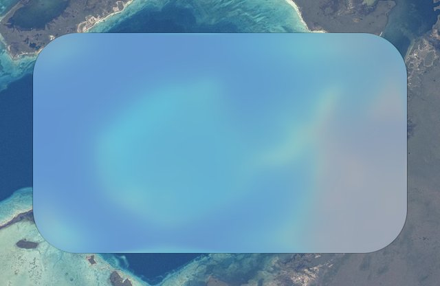
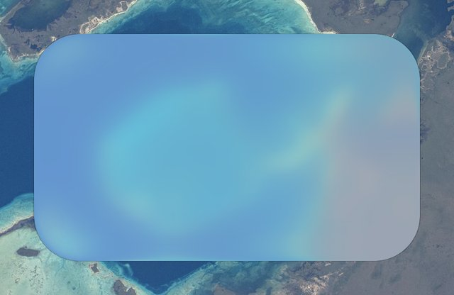
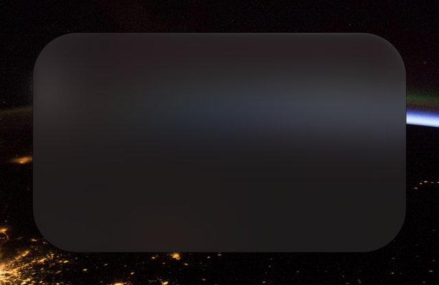
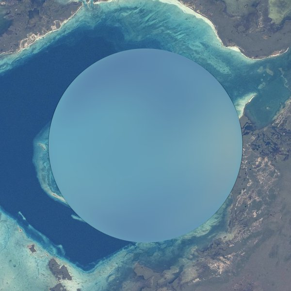
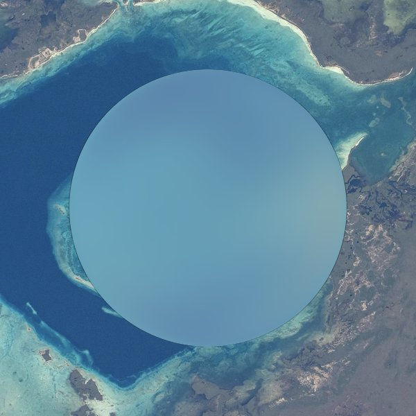
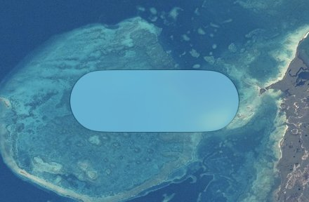
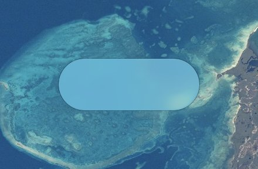
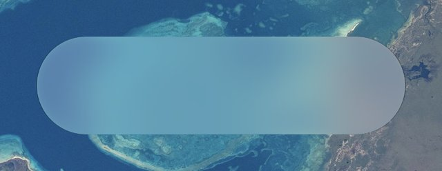
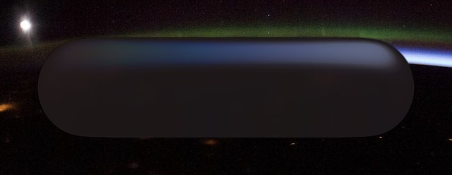
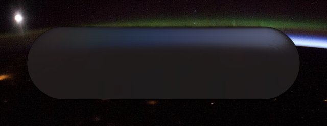

# liquid-glass-electron

Liquid glass for Electron: Apple's Liquid Glass look, built from a primitive you can bend, fade, reshape and animate,
on any element of an Electron app.

<p align="center"></p>

Electron is Chromium, and Chromium's `backdrop-filter` accepts an SVG filter. An `feDisplacementMap` in that filter
bends whatever the compositor has already drawn behind the element, on the GPU. So the glass needs no copy of the page,
no WebGL and no render loop. Text, video, CSS animations and scrolling content bend through it as they change, and when
nothing on screen changes it costs nothing at all.

- **The optics are [liquidglass](https://github.com/ybouane/liquidglass)'s**, at the same option names and defaults: a
  quarter-circle bevel that bends light where it enters and where it leaves, slight magnification toward the middle,
  colour fringing at the rim, and its Fresnel, specular and edge light. At its defaults this library's glass differs
  from liquidglass's about as much as liquidglass differs from itself moved by one pixel (see
  [the comparison](#compared-with-liquidglass)).
- **Apple's knobs:** regular, clear and identity glass, regular and clear as macOS 27 draws them (measured against
  SwiftUI's own glass on a Mac: [the comparison](#compared-with-macos)), the lens of iOS 26's small controls (measured
  from an iPhone), tints, interactive glass, capsules, circles, concentric and continuous ("squircle") corners, containers
  whose glass flows together, morphing, materializing, `.glass` and `.glassProminent` buttons, scroll edges, the
  system's Clear/Tinted setting, Reduce Transparency, Increase Contrast and Reduce Motion. [docs/APPLE.md](docs/APPLE.md) maps each part of Apple's API to this one.
- **A primitive, not a widget set.** Every visual parameter can change every frame without rebuilding the filter:
  `strength` takes glass from nothing to full and back within an animation, the way iOS 26 turns a slider's knob into
  glass only while it's held. Any shape works, including any SVG path.
- **Easy to drop in:** `glass(el)`, or `data-glass` on an element; options as data attributes or CSS custom properties.
  One ES module, TypeScript types, no dependencies. It runs in sandboxed, context-isolated renderers under a strict
  Content-Security-Policy, and falls back to a plain blur outside Chromium.

## Install

From GitHub (not on npm yet):

```bash
pnpm add github:CharlExMachina/liquid-glass-electron   # or: npm install github:CharlExMachina/liquid-glass-electron
```

`dist/` is committed, so there's nothing to build (`pnpm bundle` rebuilds it; the script isn't called `build`, because
a package manager installing from GitHub would then install the dev dependencies to prepare the package). To use it
without a bundler, see [docs/ELECTRON.md](docs/ELECTRON.md#loading-it).

## Use

```js
import { glass } from 'liquid-glass-electron';

const toolbar = glass(document.querySelector('.toolbar'), { variant: 'regular', shape: 'capsule' });
toolbar.set({ strength: 0.5 });           // cheap enough for every frame
await toolbar.animate({ strength: 1 }, { duration: 250, easing: 'ease-out' });
toolbar.destroy();                        // the element's own styles come back
```

Declaratively, for every element with `data-glass`, now and as they're added:

```js
import { autoGlass } from 'liquid-glass-electron';
autoGlass();
```

```html
<nav data-glass="regular" data-glass-shape="capsule">…</nav>
<div data-glass data-glass-refraction="0.4" data-glass-floating>drag me</div>
<div data-glass='{"bevelMode": 1, "refraction": 1.4}'>a magnifier</div>
```

Or in CSS: every option is a custom property, `--glass-` and its name in kebab case. Changes to the element's class or
data attributes are picked up, and a transition or animation of a `--glass-*` property is followed a frame at a time:

```css
.knob { --glass-strength: 0; background: white; transition: --glass-strength 0.25s, background 0.25s, scale 0.3s; }
.knob:active { --glass-strength: 1; background: transparent; scale: 1.4; }   /* white at rest, glass while held */
```

(Every number option's property is registered as a number, so it interpolates: transition any of them. Don't register
one yourself with `@property`: its initial value would reach every glass element.)

Custom properties inherit, so one set on `:root` reaches every glass element: give the page's own variables other
names. Libre Hub's earlier engine's short names work too (`--glass-bevel` for `zRadius`, `--glass-aberration`,
`--glass-edge`, `--glass-dome`, `--glass-blur`, `--glass-radius`), but its `--glass-tint`, a background colour, is
this library's `tint` option.

Glass next to other glass shares a backdrop filter by itself: sibling glass elements that don't overlap are bent by
one filter on a layer just behind them, which is most of what glass costs per frame (30 elements take 4.8× less,
[measured](#many-glass-elements-groups)). Each element stays glass of its own, with its own options, light, shadow,
pointer behaviour and handle, and looks the same; one that changes on its own (hover, a press, a different strength, a
move) gets a filter of its own while it does, in the same frame. `group: false` (or `data-glass-group="false"`) keeps an
element on a filter of its own always.

To change many elements together and keep them one filter, group them yourself:

```js
import { glassGroup, glassOf } from 'liquid-glass-electron';

const tiles = glassGroup(document.querySelector('.grid'), { variant: 'regular' });   // its data-glass children
// or glassGroup([...document.querySelectorAll('.tile')], options)
tiles.set({ strength: 0.6 });                            // all of them together: still one filter
glassOf(document.querySelector('.tile')).set({ strength: 0.3 });   // one on its own: a filter of its own while it differs
```

The members must be siblings that don't overlap, with nothing painted between them near their edges
([the rules](docs/AGENTS.md#rules-for-groups-glassgroup)); glass grouped by itself is held to that, a group made with
`glassGroup` is trusted with it. The gallery's **Lots of glass** demo (`demo/demos/many.js`) switches 24 tiles between
`group: false`, `glass()` and `glassGroup()`, and counts their backdrop filters.

The rest of the API:

| | |
|---|---|
| `container(el, { spacing })`, `data-glass-container="16"` | Apple's GlassEffectContainer: the glass shapes inside (`data-glass` or `data-glass-member`) are one piece of glass, flowing together where they come within `spacing` px |
| `union([a, b], options)` | Apple's glassEffectUnion: separate elements as one piece of glass |
| `glassGroup(elements \| parent, options)` | many glass elements, one backdrop filter: each stays glass of its own and looks the same. Sibling glass is grouped by itself; this is for a group you control (`set()`/`animate()` on all of them, keeping them one filter; see [Performance](#many-glass-elements-groups)) |
| `morph(from, to)` | the glass of one element flows into another (Apple's glassEffectID) |
| `materialize(el, 'in' \| 'out')` | glass grows in or fades away in place |
| `glassButton(el, 'glass' \| 'prominent')` | Apple's `.glass` and `.glassProminent` button styles |
| `scrollEdge(scroller, { style: 'soft' \| 'hard' })` | content dissolving into a blur under a bar |
| `setEnvironment({ dark, appearance, reduceTransparency, increaseContrast, reduceMotion, wideGamut })` | what the glass adapts to, if not the page's media queries |
| `unglass(el)`, `glassOf(el)`, `refreshAll()` | |

## If you are an AI agent

Read [docs/AGENTS.md](docs/AGENTS.md) (also in the installed package, `node_modules/liquid-glass-electron/docs/AGENTS.md`): the whole API on one page, recipes for what people build with glass, the rules
that silently break it, and which demo shows each one working. The demos in `demo/demos/` are reference code, the
iOS controls (`ios.js`) especially: glass that turns on for part of an animation, slides, swells and flows into menus.
The short version: this is a primitive, so you can build whatever you want with it. Any element, any shape, any
amount of glass, changed every frame.

## Options

liquidglass's options, with its defaults:

| Option | Default | What it does |
|---|---|---|
| `refraction` | 0.69 | How much the bevel bends what's behind it. 0 = no bending at all (light, fill and shadow only, which cost nothing per frame) |
| `zRadius` | 40 | The bevel's depth, px: how far in from the edge it curves |
| `bevelMode` | 0 | 0 = a pill with a bevelled rim; 1 = a dome that magnifies the whole element; 2 = Apple's lens (this library's): the rim magnifies toward the middle, most at the edge and fading out `zRadius` px in, and the middle is flat; 3 = Apple's switch lens, measured from iOS's switch: it shrinks what's behind it, and its rim folds back (scaled to the element, not `zRadius`); 4 = macOS 27's glass, measured against SwiftUI's: the rim samples inward along its normal, by an amount and height that follow the element's shorter side (`zRadius` caps the height), and the frost follows it too (the `regular` and `clear` variants are this) |
| `chromAberration` | 0.05 | Colour fringing at the rim. Two more passes per frame; 0 for less work |
| `blurAmount` | 0 | Frost: 1 ≈ a 7.6 px blur |
| `saturation`, `brightness` | 0, 0 | Boosts (0.5 = 1.5×), on top of `baseBrightness` |
| `tintStrength` | 0 | A tint toward liquidglass's cool glass, or toward `tint` |
| `edgeHighlight`, `fresnel`, `specular` | 0.05, 1, 0 | The light: the edge's stroke and glow, reflection at grazing angles, highlights from four lights |
| `distortion` | 0 | Micro-noise in the bending, like textured glass |
| `cornerRadius` | the element's own `border-radius` | px |
| `opacity` | 1 | How much of the glass shows over the plain backdrop |
| `shadowOpacity`, `shadowSpread`, `shadowOffsetY` | 0.3, 10, 1 | liquidglass's shadow |
| `floating` | false | Drag to move |
| `button` | false | Hover brightens, a press flattens the bevel and deepens the shadow |

And this library's:

| Option | Default | What it does |
|---|---|---|
| `baseBrightness` | 0.06 | The brightening liquidglass's glass always has (6%); 0 for none |
| `strength` | 1 | How much glass there is, 0..1: bending, fringe, frost, colour, light, fill and shadow together. Cheap to change every frame; at 0 there's no filter |
| `variant` | none | `regular` and `clear`, macOS 27's glass ([measured](#compared-with-macos)): frost, a lens along the rim, macOS's colour for light and dark, a thin outline, no fringe, light or shadow (`clear` is twice as frosted, with less colour); `identity` (no glass). None is liquidglass's glass |
| `colorMatrix` | – | The backdrop's colour as a matrix, 12 numbers (rows of red, green and blue gains and an offset), before saturation, brightness and tint; `'auto'` is macOS's for the variant, light or dark, and the display's gamut |
| `outline`, `outlineTop` | 0, 0 | macOS's thin dark line around the edge: its opacity where the edge faces sideways, and up or down |
| `shape` | `rect` | `rect`, `capsule`, `circle`, `concentric` (the radius of the glass it sits in, less the inset), `squircle` (continuous corners), `path` |
| `path`, `pathBox` | – | For `shape: 'path'`: SVG path data, in the element's px or in a viewBox (`"0 0 100 100"`) stretched over it |
| `fill` | – | A colour over the glass (Apple's tinted glass, prominent buttons). Painted with the light, so a CSS reset can't remove it |
| `surface` | – | How the glass's surface changes what it shows, per pixel, as no blend can: two images' URLs, greys stretched over the element, a gain and an offset (½ is none): out = gain × glass + offset. Apple's knobs add light at the rim and take it away at the edge (the controls page measures and draws macOS's). In CSS, `--glass-surface: url(…) url(…)` |
| `tint` | – | The colour `tintStrength` multiplies toward |
| `backdrop` | – | CSS filter functions applied before the glass, as written (`blur(2px) saturate(1.4)`), for a look already written in CSS |
| `interactive` | false | Apple's `.interactive()`: a press grows the glass, bends it more and lights it where it's pressed |
| `press`, `pressBulge` | –, 0.25 | What a press does: `bulge` (bend more), `flatten` (button mode), `none` |
| `elasticity` | 0.15 | Floating glass stretches along the way it's dragged, by how fast, and springs back. 0 = rigid |
| `smooth`, `magnify` | true, true | The smoothing that keeps the rim free of grain; the slight magnification of a pill |
| `adaptive` | true | Follow Clear/Tinted, Reduce Transparency and Increase Contrast |
| `group` | true | Share one backdrop filter with sibling glass where that looks the same ([Performance](#many-glass-elements-groups)). `false` = a filter of its own, always |

## How it works

Each glass element gets an SVG filter of its own, used as `backdrop-filter: url(#…)`. The filter smooths the backdrop
slightly (Chromium's displacement samples the nearest pixel, so where the rim squeezes the backdrop, unsmoothed pixels
turn to grain; smoothing before the bend, not after, keeps the rim crisp), then bends it through a displacement map.

**The map** is one small image of the whole element, a few thousand pixels for most elements. The bevel's shift rises
steeply in the outer few pixels, which a small map stretched back up couldn't follow; but the distance from the edge is
linear there, and stretching reproduces a linear ramp exactly. So the map stores, per axis, a value laid out linearly in
distance from the edge, and a lookup table (`feComponentTransfer`) turns it into the steep shift. Along straight edges
it's exact. Its third channel is the distance to the shape's edge, which cuts free shapes out of the box.

**Per frame**, Chromium runs every node of every glass's filter again whenever anything on the page changes, and a node
that's read twice is computed twice (the filter graph reaches the GPU process as a tree). Colour fringing bends each
channel separately, three passes that all read the map; so with fringing there are two filters, chained: the first
draws the map beside the element, in its own output, and the second reads it from there, which costs nothing to read
again.

**Light doesn't bend**, so Fresnel, specular, edge light, the fill and (for free shapes) the shadow are a `border-image`,
painted once and kept. A rounded rectangle's is a 9-slice, so a resize only moves it.

`strength`, refraction, fringe, frost, colour, light and shadow are attributes and styles on nodes that already exist,
so changing them, even every frame, rebuilds nothing.

## The demos

```bash
pnpm demo                 # the gallery
pnpm playground           # every option, live
pnpm demo:native          # the same gallery in SwiftUI, with macOS's own glass (on a Mac with macOS 26+)
pnpm playground:native    # its playground
```

The native gallery (`native/Gallery.swift`, a SwiftUI twin of each demo in `native/demos/`) has every page of the
Electron one, laid out the same, with Apple's glass where this library's is: `glassEffect`, `GlassEffectContainer`,
`glassEffectID`, `.materialize`, the `.glass` and `.glassProminent` button styles, the scroll edge effect, and macOS's
own sliders, switches and menus. Its Tinted glass and the accessibility switches are the system's settings, set for
that app alone. Where this library does something macOS's glass doesn't (a dome that magnifies, liquidglass's own look
and presses), the native page uses the nearest thing a Mac has and says so. `--page=<name>`, `--theme=light|dark` and
`--size=WxH` work as they do for `pnpm demo`.

The gallery runs sandboxed, context-isolated and under a strict Content-Security-Policy. Photos and video are NASA's
([credits](demo/assets/CREDITS.md)).

<table>
<tr><td width="50%"><br><b>Toolbar</b>: grouped buttons on capsules of glass (<a href="https://raw.githubusercontent.com/CharlExMachina/liquid-glass-electron/media/toolbar.mp4">MP4</a>, <code>demo/demos/toolbar.js</code>)</td><td width="50%"><br><b>Tab bar</b>: a floating tab bar and a separate search button (<a href="https://raw.githubusercontent.com/CharlExMachina/liquid-glass-electron/media/tabbar.mp4">MP4</a>, <code>demo/demos/tabbar.js</code>)</td></tr>
<tr><td width="50%"><br><b>Over scrolling content</b>: a bar floating over a scrolling page, with a soft scroll edge (<a href="https://raw.githubusercontent.com/CharlExMachina/liquid-glass-electron/media/scroll.mp4">MP4</a>, <code>demo/demos/scroll.js</code>)</td><td width="50%"><br><b>Sliders and toggles</b>: knobs that turn to glass while held (<a href="https://raw.githubusercontent.com/CharlExMachina/liquid-glass-electron/media/controls.mp4">MP4</a>, <code>demo/demos/controls.js</code>)</td></tr>
<tr><td width="50%"><br><b>Buttons</b>: <code>.glass</code> and <code>.glassProminent</code>, interactive glass (<a href="https://raw.githubusercontent.com/CharlExMachina/liquid-glass-electron/media/buttons.mp4">MP4</a>, <code>demo/demos/buttons.js</code>)</td><td width="50%"><br><b>Toasts</b>: notifications materializing and leaving (<a href="https://raw.githubusercontent.com/CharlExMachina/liquid-glass-electron/media/toasts.mp4">MP4</a>, <code>demo/demos/toasts.js</code>)</td></tr>
<tr><td width="50%"><br><b>Morphing</b>: a button's glass flowing into a sheet and back (<a href="https://raw.githubusercontent.com/CharlExMachina/liquid-glass-electron/media/morph.mp4">MP4</a>, <code>demo/demos/morph.js</code>)</td><td width="50%"><br><b>Merging glass</b>: shapes in a container flowing together and splitting (<a href="https://raw.githubusercontent.com/CharlExMachina/liquid-glass-electron/media/container.mp4">MP4</a>, <code>demo/demos/container.js</code>)</td></tr>
<tr><td width="50%"><br><b>Dragging</b>: floating glass that stretches as it moves (<a href="https://raw.githubusercontent.com/CharlExMachina/liquid-glass-electron/media/drag.mp4">MP4</a>, <code>demo/demos/drag.js</code>)</td><td width="50%"><br><b>Dock</b>: a dock of icons on one piece of glass (<a href="https://raw.githubusercontent.com/CharlExMachina/liquid-glass-electron/media/dock.mp4">MP4</a>, <code>demo/demos/dock.js</code>)</td></tr>
<tr><td width="50%"><br><b>Over video</b>: glass bending a playing video (<a href="https://raw.githubusercontent.com/CharlExMachina/liquid-glass-electron/media/video.mp4">MP4</a>, <code>demo/demos/video.js</code>)</td><td width="50%"><br><b>Magnifier</b>: a dome lens (<a href="https://raw.githubusercontent.com/CharlExMachina/liquid-glass-electron/media/magnifier.mp4">MP4</a>, <code>demo/demos/magnifier.js</code>)</td></tr>
<tr><td width="50%"><br><b>Clear, tinted, accessible</b>: Clear/Tinted, Reduce Transparency, Increase Contrast, light and dark (<a href="https://raw.githubusercontent.com/CharlExMachina/liquid-glass-electron/media/appearance.mp4">MP4</a>, <code>demo/demos/appearance.js</code>)</td><td width="50%"><br><b>Playground</b>: every option, live, including any SVG path as the shape (<a href="https://raw.githubusercontent.com/CharlExMachina/liquid-glass-electron/media/playground.mp4">MP4</a>, <code>demo/demos/playground.js</code>)</td></tr>
</table>

Also in the gallery: **Lots of glass**, 24 glass tiles over a scrolling feed, each on a filter of its own, grouped by
`glass()` or in a `glassGroup`, with a count of their backdrop filters (`demo/demos/many.js`).

## Performance

Measured with `pnpm bench` ([bench/run.mjs](bench/run.mjs)): every library below in the same scenes, in an Electron
window of 1180 × 800 on a second display, unfocused. The number is the CPU time of Chromium's GPU process (where backdrop
filters and WebGL are drawn), as Electron's `app.getAppMetrics()` reports it, in % of one core: over 8 seconds after a
2-second warm-up, three runs per library interleaved with the others, the median. The renderer process's time and the
frames drawn per second are in [the results](bench/results/2026-10-25/results.md) too. Machine: AMD Ryzen 9 7950X,
Radeon RX 7900 XTX (Mesa), Linux, Electron 44.9.3 (Chromium 152), a 4K display at 1.25×.

The scenes, over a photo:

- **idle**: four panels of 300 × 160 px, nothing changing.
- **content**: the same, and a number on the page changing ten times a second.
- **move**: one of the four panels moving every frame.
- **scroll**: a page of text and photos scrolling under the four panels.
- **10 / 30 elements**: 10 or 30 capsules of 170 × 64 px while the page scrolls.

| GPU process, % of a core | idle | content | move | scroll | 10 elements | 30 elements |
|---|---|---|---|---|---|---|
| no glass | 0 | 1.0 | 0.2 | 4.1 | 4.2 | 4.2 |
| plain CSS `backdrop-filter: blur() saturate()` | 0 | 1.7 | 9.5 | 9.9 | 16.1 | 41.8 |
| **liquid-glass-electron**, defaults (colour fringing on) | **0** | **1.7** | **10.9** | **8.7** | **9.2** | **12.9** |
| **liquid-glass-electron**, `chromAberration: 0` | **0** | **1.5** | **10.2** | **7.7** | **7.6** | **10.7** |
| liquid-glass-electron, `group: false` (every glass on a filter of its own) | 0 | 2.2 | 13.5 | 13.9 | 23.0 | 61.8 |
| liquid-glass-electron, `group: false`, `chromAberration: 0` | 0 | 1.9 | 10.6 | 9.6 | 15.4 | 36.7 |
| [@ybouane/liquidglass](https://github.com/ybouane/liquidglass) 1.0.3 (WebGL) | 11.5 | 12.4 | 16.2 | 28.3 | 53.3 | 110.6 ‡ |
| [liquidGL](https://liquidgl.naughtyduk.com) 3.0.0 (WebGL) | 18.1 | 19.9 | 24.4 | 19.6 | 69.4 | 147.0 * |
| [liquid-glass-react](https://www.npmjs.com/package/liquid-glass-react) 1.1.1 (SVG filter) | 0 | 11.9 | 65.8 † | 74.9 † | 80.6 † | 69.8 † |
| [apple-liquid-glass-webgl](https://github.com/Oliverrr2424/webgl-apple-liquid-glass) 2.6.0 (WebGL) | 17.4 | 19.2 | 27.0 | 27.3 | 63.1 | 104.2 ‡ |
| [simple-liquid-glass](https://github.com/lucaperullo/simple-liquid-glass) 5.4.0 (SVG filter) | 0 | 1.5 | 6.7 | 6.6 | 9.9 | 21.6 § |
| [@avenra/liquid-glass](https://github.com/DevSam7t3/liquid-glass) 1.2.0 (SVG filter) | 0 | 4.4 | 38.5 | 39.8 | 28.7 | 86.9 ‡ |

Every run drew at the display's rate (about 98 frames a second) unless marked: less CPU can also mean fewer frames.
\* liquidGL failed with 30 elements (shader errors), so that number isn't comparable.
† liquid-glass-react couldn't keep up: 52 frames a second when moving, 53 scrolling, 30 with 10 elements, 10 with 30.
‡ with 30 elements, 82 frames a second (liquidglass), 92 (apple-liquid-glass-webgl), 78 (@avenra/liquid-glass).
§ simple-liquid-glass's lens map doesn't take effect in Electron: its `<feImage width="100%">` sits in a 0 × 0 `<svg>`,
Skia gets an empty map and moves the whole backdrop by a constant 80 px instead of bending it (the mirrored look). Its
numbers are what any backdrop filter costs; with fringing, this library's glass takes 8 passes on the GPU per filter.

What this says:

- **Nothing changing costs nothing**, and neither does content changing under still glass, as with no glass at all.
  The WebGL libraries draw every frame regardless: 11–18% of a core while nothing happens.
- **Glass next to other glass shares one filter by itself** (see [groups](#many-glass-elements-groups)), and most of
  the cost is per backdrop filter, not per pixel. 30 capsules with colour fringing take 12.9% of a core, against 61.8%
  each on its own filter (`group: false`): 4.8× less, a third of a plain CSS blur on them, and less than any library
  measured. With 10, 9.2% against 23.0%.
- **Moving glass costs less than liquidglass**: 10.9% against 16.2% (the three still panels share one filter, the
  moving one has its own). Chromium runs every glass's filter again on every frame anything changes, and colour fringing
  is three bending passes; without fringing it's 10.2%, about a plain CSS blur's 9.5%.
- simple-liquid-glass costs less with the four panels (moving and scrolling), but it doesn't bend them (§). With 10 or
  30 elements this library costs less than it.

Every library was checked for drawing in each scene (`bench/results/<date>/shots/`, made by the run, not committed).

### Many glass elements: groups

Most of that cost is per backdrop filter, not per pixel: each one is recorded, sent to the GPU process with its map's
pixels and run again on every frame, however small. A group keeps every element glass of its own, with its own
options, light, shadow, pointer behaviour and `glassOf()` handle, and bends all of them with one filter on a layer just
behind them: the members' own filter, with their maps copied into one image and clipped to their shapes. Members of
the same size draw their maps on one grid, whole map pixels apart (each draws that same map on its own too, so it looks
the same in the group and out of it), and one image holds them all. It draws the same pixels as separate glass, but for
the antialiasing of the rim's outermost pixel and, at fractional scales like 1.25×, scattered pixels that round the
other way; a map redrawn on a group's grid (a fraction of a px finer) moves a few more rim pixels.

`glass()` groups siblings by itself (an implicit group), and is strict about it: a member is drawn by the layer only
if nothing is painted between the layer and it over what it bends, only glass near together shares a layer (the layer
bends everything in its box, so far-apart glass in one would cost the GPU more pixels than it saves the CPU), and a
parent is made a containing block only if nothing else in it would move. `glassGroup(elements)` (or
`glassGroup(parent)`, for its children with `data-glass`) makes a group you control:

```js
const tiles = glassGroup(document.querySelector('.grid'), { shape: 'capsule' });
tiles.set({ strength: 0.6 });                            // every member together: still one filter
glassOf(tiles.elements[0]).set({ strength: 0.3 });       // one member on its own: its own filter while it differs
```

In the move scene the moving panel has its own filter while it moves and the other three share one. (Drawing a
moving member from the layer too was tried and measured: redrawing the layer's clip every frame costs more than the
filter it saves.)

A member leaves the group, in the same frame, while it changes on its own (strength, colour, hover, a press, a drag,
a transition or animation, a resize, a move) and joins again once it has kept still for ~120 ms; one that keeps moving
keeps its own filter and doesn't hold the others up. `set()` and `animate()` on the group change every member together
and keep them one filter. A move that touches nothing on the member (a stylesheet rule, a layout shift among its
siblings, `el.animate()`) is seen too, a frame later: an IntersectionObserver whose root box is the member's own box
fires as soon as it moves, for nothing per frame meanwhile. What a group needs (details in
[docs/AGENTS.md](docs/AGENTS.md#rules-for-groups-glassgroup)):

- **Siblings that don't overlap, with nothing painted between them near their edges.** The layer bends the backdrop
  of all of them before any paints, so one member's rim doesn't bend another member's glass (or a sibling drawn between
  them), as separate glass within a few dozen px would. That's Apple's rule too: glass doesn't sample other glass.
- Free shapes (`squircle`, `path`), a dome's fringe (`bevelMode: 1` with `chromAberration`), `distortion`, `backdrop`,
  sticky members, and members with their own `opacity`, `filter`, `mask`, `clip-path`, `mix-blend-mode`, rotation or
  scale keep a filter of their own (correct, just not cheaper).

## Compared with liquidglass

`pnpm compare` ([bench/compare/run.mjs](bench/compare/run.mjs)) draws the same scene with
[@ybouane/liquidglass](https://github.com/ybouane/liquidglass) (WebGL) and with this library, at the same options
(liquidglass's defaults) and a device scale factor of 1, and measures the mean difference per channel (0–255) in three
zones: the rim (within 40 px of the edge), the interior, and the shadow (25 px outside). As a yardstick it also
measures liquidglass against itself moved by one pixel: a difference that small is invisible, and it adds up to this
much.

| over | | rim | interior | shadow |
|---|---|---|---|---|
| a coast (NASA) | liquid-glass-electron | 3.1 | 1.8 | 0.2 |
| | Libre Hub's earlier engine | 3.9 | 1.4 | 0.5 |
| | liquidglass moved 1 px | 2.6 | 2.7 | |
| mountains (NASA) | liquid-glass-electron | 4.1 | 1.4 | 0.1 |
| | Libre Hub's earlier engine | 5.4 | 1.1 | 0.4 |
| | liquidglass moved 1 px | 4.1 | 2.2 | |

Inside the glass it's well within a pixel's shift of liquidglass; at the rim, within it over the mountains and a little
over it over the coast. Compared with the engine it grew from, the rim is closer to liquidglass and crisp (smoothing
before the bend, not a blur after it) and the interior a little further, still within the yardstick.


## Compared with macOS

`regular` and `clear` are macOS 27's glass, measured against SwiftUI's own `glassEffect` on a Mac (Apple M4 Max,
built-in Display P3 screen, macOS 27.0.1). `native/Glass.swift` draws a scene with SwiftUI; `test/native/` draws the
same scene with this library; both windows are captured with `screencapture`, at 2× in the display's colour space.
Without glass the two captures differ by 0.2 levels of 255 on average (a level at most), so what differs with glass is
the glass. AppKit's `NSGlassEffectView` draws the same pixels as SwiftUI's, to the bit.

The same scenes, each captured from a real window: macOS's own glass on the left, this library's on the right
(photos from NASA, [credits](demo/assets/CREDITS.md)):

<table>
<tr><th>macOS 27 (SwiftUI <code>glassEffect</code>)</th><th>liquid-glass-electron</th></tr>
<tr><td width="50%"></td><td width="50%"></td></tr>
<tr><td colspan="2"><code>.regular</code>, light, a 340 × 200 panel: a mean difference of 1.3 levels of 255 inside the glass</td></tr>
<tr><td width="50%"></td><td width="50%"></td></tr>
<tr><td colspan="2"><code>.clear</code>, dark, a 340 × 200 panel: a mean difference of 0.5 levels of 255 inside the glass</td></tr>
<tr><td width="50%"></td><td width="50%"></td></tr>
<tr><td colspan="2"><code>.clear</code>, light, a 200 px circle: a mean difference of 0.5 levels of 255 inside the glass</td></tr>
<tr><td width="50%"></td><td width="50%"></td></tr>
<tr><td colspan="2"><code>.regular</code>, light, a 120 × 44 capsule: a mean difference of 1.4 levels of 255 inside the glass</td></tr>
<tr><td width="50%"></td><td width="50%"></td></tr>
<tr><td colspan="2"><code>.clear</code>, light, a 300 × 80 capsule: a mean difference of 0.6 levels of 255 inside the glass</td></tr>
<tr><td width="50%"></td><td width="50%"></td></tr>
<tr><td colspan="2"><code>.regular</code>, dark, a 300 × 80 capsule: a mean difference of 4.5 levels of 255 inside the glass</td></tr>
</table>

How each part was measured (details in [docs/APPLE.md](docs/APPLE.md#how-macos-27-draws-it-and-how-this-was-measured)):
flat colours and nine greys for the colour, an edge for the frost, linear ramps across the rim for the lens (a ramp
blurred stays a ramp, so the level under the glass says where it was sampled from, to a pixel), and the inputs of the
`glassBackground` filter read from the glass's layers, for what changes with size. Then a model of it was fitted, and
the library draws that model with the filter nodes it already had.

Mean difference per channel (0–255) inside the glass, over photos no fit ever used (night here, and two macOS
wallpapers), four shapes from a 120 × 44 capsule to a 340 × 200 panel:

| | before (liquidglass's look, a faint fill) | now | 95th percentile now | edge (±2 px) now |
|---|---|---|---|---|
| `regular`, light | 55.5 | **1.4** | 3.5 | 5.0 |
| `regular`, dark | 18.2 | **4.5** | 7.1 | 5.3 |
| `clear`, light | 52.7 | **0.7** | 1.8 | 2.4 |
| `clear`, dark | 19.1 | **0.7** | 1.8 | 1.8 |

Clear glass measures 0.4–0.8 at every size from a 28 px capsule to a 500 × 300 panel; regular glass in the light 1.0–1.4.

- Two blind judges (agents shown each scene as A and B, native on a random side, and four labelled examples of native
  glass on other photos) told the earlier variants from macOS in 24 of 24 trials, and these in 12 of 24: chance.
- The test (`pnpm test:native`) holds each of its 18 cases to within a quarter of what it measures now, inside the glass,
  at its rim, at its edge and just outside it, and `pnpm test:native --self-check` draws the glass wrong on purpose
  (the lens off, 30% less frost, a little more saturation, no outline) and checks that the cases catch each.
- Dark regular glass is the furthest from macOS (about 3–5 levels): macOS caps its brightness by luma and blends a
  wider blur over it by darken, and the fit of both is weakest there.

Measured with `pnpm bench` on the Mac (Electron 44, the built-in display, five runs each, interleaved: the scenes of
[Performance](#performance)), the variants cost what they did before within the run-to-run noise, which for the same
code is ±5 points of the GPU process and ±1.5 of the renderer: regular glass the same or less in every scene, clear
glass the same or less in the GPU process and about 2 points more in the renderer with 10 or 30 elements (macOS's
frost is wide, where the earlier clear glass had none), and every run at the display's rate
([results](bench/results/2026-10-26/results.md)). macOS's glass needs no colour fringe, so it's one filter where
liquidglass's look is two; its blur fill and dark cap add nodes Skia draws with the passes already there.

## Limitations

- **Chromium only.** Electron, Chrome and Edge bend the backdrop; Firefox and Safari accept the syntax but draw nothing,
  so there the glass is a plain blur with its light, fill and shadow (`globalThis.LIQUID_GLASS_FALLBACK = true` shows
  what that looks like).
- **Every glass costs something on every frame anything on the page changes**, even glass whose own backdrop didn't
  change: Chromium runs every backdrop filter again for each frame. Idle, it's nothing; while something animates or
  scrolls, it's roughly proportional to the number of glass elements on screen (see [Performance](#performance)). Glass
  at `strength` 0 has no filter and costs nothing; so does `refraction: 0` (light and fill only). A container draws
  all of its members with one filter, and so does a group: sibling glass that doesn't overlap, with nothing painted
  between, is grouped by itself.
- **An ancestor with `opacity` below 1, a `filter`, a `mask`, `clip-path` or `mix-blend-mode` turns the bending off**
  inside it: CSS's rule (the backdrop root). Glass inside glass is fine (the outer glass paints on a layer behind its
  content, so the inner one sees through it, as Apple's does), but inside such glass, keep a `mix-blend-mode` in an
  element of its own (`isolation: isolate` on its parent): blending isolates the outer glass, which then sees nothing
  behind it.
- **The page can't read the pixels behind an element**, so the glass can't switch between light and dark by itself, as
  Apple's small controls do over changing content. Set the theme (`data-glass-theme`, `setEnvironment({ dark })`).
- **A glass element's own border isn't drawn**: the light is a `border-image`. Its border width still lays out. Use
  `edgeHighlight` instead of a border.
- **Bending samples the nearest pixel** (that's Chromium's feDisplacementMap), so the backdrop is smoothed slightly
  first (σ ≈ 0.7 px), which softens fine detail under the glass a little. `smooth: false` turns it off, with grain
  where the rim squeezes the backdrop.
- **Specular highlights and strong edge light are laid over as white**, where liquidglass adds them to the colour: at
  high `specular` they're dimmer over mid-tones than liquidglass's. At its defaults (`specular` 0) it makes no
  visible difference.
- **Colour fringing follows Libre Hub's model**: each channel bent by its own share of the bevel's shift. At the
  default `chromAberration` it matches liquidglass (see the comparison); turned up, its fringes are about twice as wide
  at the rim as liquidglass's. A dome (`bevelMode` 1) uses liquidglass's exact fringe.
- **Maps are small**: a few thousand pixels, exact along straight edges thanks to their lookup tables, approximate in
  tight corners of large elements. They're drawn on the CPU when an element's size settles (a few ms), and stretched
  while it's changing; containers and morphs moving their shapes draw them every frame, at half the resolution.
- **Free shapes** (`path`) are rasterised to work out their distances, at most about 400 × 400, so very fine details of
  a large path are softened, and their magnification pulls toward the middle of the box, not of the shape.
- **The OS's Clear/Tinted setting can't be read** on any platform; offer it as the app's own setting. Reduce
  Transparency and Increase Contrast come from the page's media queries, which Chromium fills in on macOS and Windows;
  on Linux pass them from the main process ([docs/ELECTRON.md](docs/ELECTRON.md#the-systems-settings)).
- **Apple's lens (`bevelMode` 2) is measured from one control**, an iPhone's slider knob. Its rim folds back like thick
  glass, and Chromium's nearest-pixel sampling leaves a one-pixel stair along what it folds, where the iPhone's is
  smooth. The thin dark line around the iPhone's rim and the shading across its glass aren't part of the glass here;
  the iOS demo draws them in CSS (`demo/demos/ios.css`).
- **Apple's switch lens (`bevelMode` 3) is measured from one control too**, iOS 26's switch knob (an iPhone app on a
  Mac, held over lines of known places): its shift is matched to within 0.2 px, and its outline, shading, rim light
  and shadow are an image the iOS demo draws (`surface()` in `demo/demos/ios.js`). Where the knob refracts the blue
  track, iOS's rim light turns cyan; here it stays white.
- **Maps travel as greys and alpha.** Chromium composites in the display's colour space (Display P3 on a wide-gamut
  Mac) and converts a coloured map into it before bending, which bent up and left by as much as a fifth less than down
  and right. A grey is the same in both spaces and alpha isn't converted, so each shift has an image of its own, and
  the map a displacement reads is the shift down as a grey and the shift across as alpha, at half the levels of a byte
  each (128 a side). With chromatic aberration (two filters, the maps stashed between them), the shift across still
  comes out about 0.25 px to the right on such a display.
- **The variants are macOS 27.0.1's glass, on a wide-gamut display**: its colour is fitted to what Chromium filters
  there, in the display's colour space. On an sRGB display they use matrices fitted from the same captures converted
  to sRGB, which no sRGB display has checked. Measured: both variants, light and dark, sizes from 28 to 300 px. Not
  measured, so this library's own guess: macOS's Liquid Glass tint setting (`appearance: 'tinted'`), Increase Contrast,
  Reduce Transparency, `.tint(_:)` (here `fill`), glass in a container, a pressed `.interactive()` glass, and macOS
  versions other than 27.0.1 (`pnpm test:native --update` captures them on yours).
- **macOS frosts the backdrop around the glass too**; a backdrop filter in Chromium sees only what's under the element,
  so in the outermost few pixels the frost leans toward the glass's own edge. The outline is box-shadows (rounded
  rectangles only: free shapes and containers have none).
- Not done: Apple's shimmer on interactive glass, `backgroundExtensionEffect`.

## Tests

With [pnpm](https://pnpm.io) (`pnpm install`; it runs esbuild's install script and not a benchmark dependency's broken
one, see `pnpm-workspace.yaml`) and Node 22.18 or later, which runs the unit tests' TypeScript as it is:

```bash
pnpm test              # the optics, fields, maps, options and groups' geometry (node:test)
pnpm test:visual       # screenshots in Electron against test/visual/baseline/
pnpm test:native       # on a Mac: the glass against macOS's own, test/native/reference/ (see below)
pnpm typecheck
```

`pnpm test:native` draws each case of `test/native/cases.js` with this library and compares it with SwiftUI's
`glassEffect` drawing the same scene, captured on a Mac into `test/native/reference/` (`pnpm test:native --update`
captures them again, with `native/Glass.swift`). Both windows go through `screencapture`, so where there's no glass they
match to within a level; inside the glass each case has a limit on how far from macOS it may be, and a report
(`test/native/out/report.html`) shows macOS's glass, this library's and the difference. `--self-check` draws the
glass wrong on purpose and fails unless the cases catch it; `--calibrate` writes the limits (`test/native/limits.json`)
from what the glass measures now, which is for after a change meant to move the glass closer to macOS. It needs Screen
Recording permission for the terminal, and stops if macOS's version, the display's gamut or its scale differ from the
references'.

The visual baselines are drawn by the GPU, so they belong to a machine (these are from Linux, Mesa, AMD). On another,
write your own first with `pnpm test:visual --update`, then the test catches changes from there.

## Credits

The optics are [liquidglass](https://github.com/ybouane/liquidglass)'s (MIT), by [ybouane](https://github.com/ybouane). The engine grew out of
[Libre Hub](https://github.com/CharlExMachina/LibreHub)'s. Apple's Liquid Glass is the reference for the API's knobs.
Photos and video: NASA.

MIT license.
